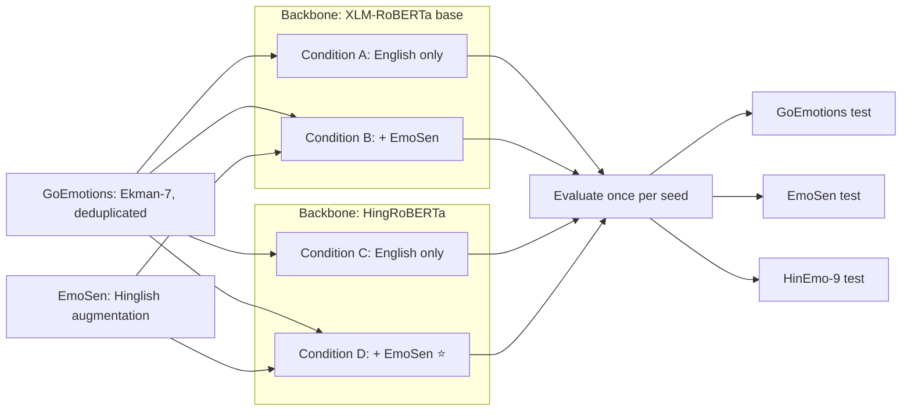
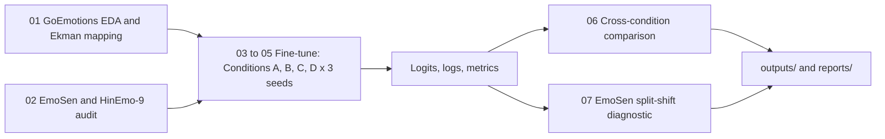
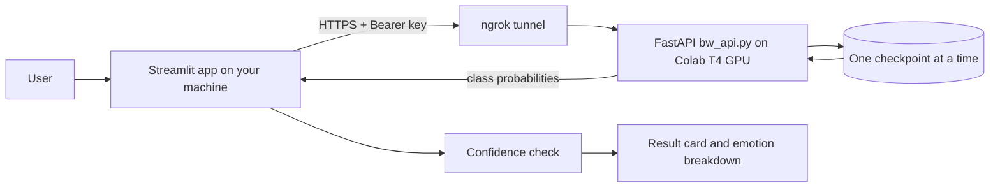
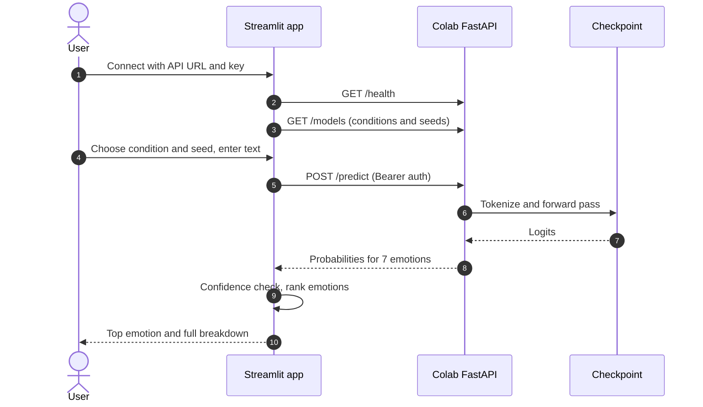

# Beyond Words

**Cross-lingual Emotion Analysis in English & Romanized Hinglish**
*A 2×2 factorial transformer experiment · Research prototype*

> Understand the emotion behind the words, including the mixed Hindi–English text that dominates South Asian social media, with **transparent evaluation, honest limitations and confidence checks**.


<!-- Tip: add a screenshot of the app at docs/app_screenshot.png and uncomment the line below

-->

---

## Table of Contents

1. [Overview](#1-overview)
2. [Design Principles](#2-design-principles)
3. [Experimental Design](#3-experimental-design)
4. [Key Results](#4-key-results)
5. [System Architecture](#5-system-architecture)
6. [Quickstart: Running the App](#6-quickstart-running-the-app)
7. [Project Structure](#7-project-structure)
8. [Datasets](#8-datasets)
9. [Model Weights](#9-model-weights)
10. [Notebooks Guide](#10-notebooks-guide)
11. [Limitations](#11-limitations)
12. [Trust, Safety & Responsible Use](#12-trust-safety--responsible-use)
13. [Roadmap](#13-roadmap)
14. [FAQ](#14-faq)
15. [Tech Stack](#15-tech-stack)
16. [Reports](#16-reports)
17. [Citation](#17-citation)
18. [License](#18-license)

---

## 1. Overview

**Beyond Words** fine-tunes multilingual transformer models to detect emotions in both **English** and **Romanized Hinglish**, the code-switched Hindi–English text written in Latin script.

It targets a well-documented gap: standard English emotion classifiers struggle with Hinglish because of **code-switching, non-standard spelling and social-media linguistic norms**.

### Seven emotion classes (Ekman mapping)

| 😠 anger | 🤢 disgust | 😨 fear | 😄 joy | 😢 sadness | 😮 surprise | 😐 neutral |
|:-:|:-:|:-:|:-:|:-:|:-:|:-:|

### What the prototype demonstrates

- A controlled **2×2 comparison** of backbone (XLM-R vs HingRoBERTa) and training data (English-only vs + Hinglish augmentation).
- **Three random seeds per condition**, reported as mean ± SD, with the test set evaluated exactly once per seed.
- A **live Streamlit app** that sends text to a Colab GPU inference API and returns a probability for every emotion.
- A **confidence check** that flags results where the top emotions are close.
- Calibration analysis (ECE, Brier score) and error analysis for each condition.

### What it deliberately does **not** claim

- No sarcasm detection. Sarcasm can invert emotional valence (module planned).
- No reading of a person's true internal state. Labels reflect annotation conventions.
- No production readiness. The live app depends on an active Colab runtime.
- No strong conclusions from small Hinglish test sets (HinEmo-9, n = 270).

---

## 2. Design Principles

1. **Controlled experiments over leaderboard chasing.** One factor changes at a time (2×2 design).
2. **Variability is reported.** Three seeds (42, 123, 2026), mean ± SD.
3. **Test set touched once.** Model selection happens before the single test evaluation per seed.
4. **Probabilities are estimates, not guarantees.** The UI says so on every result.
5. **Calibration is measured, not assumed.** Raw softmax is known to be overconfident.
6. **Reproducibility.** Frozen configs, saved logits and a smoke test that compares app predictions with saved logits.
7. **Honest limitations** are documented next to the results, not hidden.

---

## 3. Experimental Design

A **2×2 factorial** design crossing the backbone with the training data:

|   | English-only training | + Hinglish augmentation (EmoSen) |
|---|---|---|
| **XLM-RoBERTa** (base) | **Condition A** ← baseline | **Condition B** |
| **HingRoBERTa** (Hinglish-adapted XLM-R) | **Condition C** | **Condition D** ⭐ recommended |



Each condition is trained with **3 independent random seeds** (42, 123, 2026) to estimate variability. The test set is evaluated **exactly once** per seed after model selection.

---

## 4. Key Results

| Condition | Backbone | GoEmotions Macro-F1 | EmoSen Macro-F1 | HinEmo-9 Macro-F1 |
|---|---|---|---|---|
| A — XLM-R, English only | XLM-R-base | 0.722 ± 0.011 | 0.280 ± 0.006 | 0.374 ± 0.013 |
| B — XLM-R + EmoSen | XLM-R-base | 0.726 ± 0.001 | 0.287 ± 0.016 | 0.360 ± 0.021 |
| C — HingRoBERTa, English only | HingRoBERTa | **0.733 ± 0.002** | 0.353 ± 0.025 | 0.493 ± 0.021 |
| **D — HingRoBERTa + EmoSen** ⭐ | **HingRoBERTa** | 0.726 ± 0.005 | **0.368 ± 0.019** | **0.527 ± 0.006** |

> Scores are means ± SD over 3 seeds. Bold marks the highest mean in each column.

**How to read this**

- **Hinglish-adapted backbone matters most.** Moving from XLM-R (A, B) to HingRoBERTa (C, D) gives the largest gains on the two Hinglish test sets.
- **Hinglish augmentation helps most on top of HingRoBERTa.** Condition D has the best EmoSen and HinEmo-9 means.
- **English performance stays roughly level** across all four conditions on GoEmotions.
- ⚠️ The HinEmo-9 test set is small (n = 270). Differences between conditions should **not** be over-interpreted.

---

## 5. System Architecture

### 5.1 Training and evaluation pipeline



### 5.2 Live inference architecture



### 5.3 One prediction, step by step



---

## 6. Quickstart: Running the App

> **Requirements:** Python 3.10 or 3.11 locally. A GPU is **not** needed on your machine.

### Step 1: Start the Colab inference server

1. Open `colab/Beyond_Words_Colab_Server.ipynb` in [Google Colab](https://colab.research.google.com/).
2. Set the runtime to **T4 GPU** (Runtime → Change runtime type).
3. Run all cells. Enter your [ngrok authtoken](https://dashboard.ngrok.com/get-started/your-authtoken) when prompted.
4. Copy the **HTTPS API URL** and **API key** printed at the end.

### Step 2: Run the local Streamlit app

```powershell
cd app
py -3.11 -m venv .venv
.\.venv\Scripts\Activate.ps1
pip install -r requirements.txt
streamlit run app.py
```

Then enter the Colab URL and API key in the **Connect to Colab API** dialog.

> **macOS / Linux:** replace `Activate.ps1` with `source .venv/bin/activate`

### What the app gives you

| Feature | Details |
|---|---|
| **Emotion analyser** | Type English or Romanized Hinglish (up to 5,000 characters), try built-in examples, get the top emotion and a ranked probability breakdown |
| **Confidence check** | Flags results where the top two emotions are close |
| **Model settings** | Choose the experimental condition (D recommended) and training seed |
| **Theme switch** | Light / Dark / System, from the top-right dropdown or the sidebar |
| **Connect dialog** | Enter the Colab URL and API key; Logout clears them |
| **Model info & About** | Per-condition evaluation summaries from `model_cards.json` |

### Verify reproducibility (optional)

```powershell
python scripts/smoke_test.py ^
  models/english_emotion/xlmr_english_ekman7_condA/seed_42 ^
  outputs/condA/logits/test_logits_xlmr_english_ekman7_condA_seed42.csv ^
  data/processed/goemotions_ekman_dedup.csv
# Should print: PASS
```

---

## 7. Project Structure

```text
beyond-words/
│
├── notebooks/                   ← 7 Colab notebooks (run in order)
│   ├── 01_dataset_exploration.ipynb                 Phase 1: GoEmotions EDA & Ekman mapping
│   ├── 02_hinglish_dataset_audit.ipynb              Phase 1: EmoSen + HinEmo-9 audit
│   ├── 03_english_emotion_baseline.ipynb            Condition A: XLM-R, English only
│   ├── 04_english_emotion_hingroberta_condC.ipynb   Condition C: HingRoBERTa, English only
│   ├── 05_hinglish_adaptation_condB_condD.ipynb     Conditions B & D: Hinglish augmentation
│   ├── 06_hinglish_eval_ABCD_comparison.ipynb       Cross-condition evaluation
│   └── 07_emosen_split_shift_diagnostic.ipynb       EmoSen anger→disgust shift analysis
│
├── app/                         ← Streamlit local UI (connects to Colab API)
│   ├── app.py                   Full production UI (Light/Dark/System theme, all conditions)
│   ├── bw_utils.py              Shared utilities (softmax, confidence, checkpoint discovery)
│   ├── model_cards.json         Evaluation summaries for all 4 conditions
│   ├── requirements.txt         pip dependencies for the local app
│   └── README.md                How to run the app
│
├── colab/                       ← Colab inference server
│   ├── Beyond_Words_Colab_Server.ipynb   Start the FastAPI server on Colab GPU
│   └── bw_api.py                FastAPI inference service (Bearer-auth, one checkpoint at a time)
│
├── configs/                     ← Frozen experiment hyperparameters
│   ├── english_emotion_config.json         Condition A config
│   └── hinglish_adapt_condD_config.json    Condition D config
│
├── outputs/                     ← All experiment outputs (tracked in git)
│   ├── condA/                   Condition A: XLM-R English-only
│   │   ├── figures/             Confusion matrices, calibration plots, training curves
│   │   ├── logits/              Raw logit CSVs (GoEmotions, EmoSen, HinEmo-9 test sets)
│   │   ├── logs/                Per-epoch training history JSON
│   │   ├── metrics/             Calibration, Brier, ECE, multi-seed summary
│   │   └── predictions/         Error analysis CSVs
│   ├── condB/                   Condition B outputs (run NB 05 to generate → push here)
│   ├── condC/                   Condition C outputs (run NB 04/06 to generate → push here)
│   ├── condD/                   Condition D: HingRoBERTa + EmoSen 
│   │   ├── figures/             Training curves
│   │   ├── logits/              Raw logit CSVs across all test sets
│   │   ├── logs/                Training history JSON
│   │   └── metrics/             Multi-test-set evaluation summary
│   └── cross_condition/         Shared metrics: ABCD comparison CSVs, condC logits
│
├── scripts/                     ← Utility scripts
│   ├── smoke_test.py            Reproducibility check: app predictions vs saved logits
│   └── build_nb.py              Programmatic notebook builder (generates NB 03)
│
├── data/                        ← Data directory (files excluded from git, see below)
│   └── processed/
│       └── .gitkeep             Placeholder; download goemotions_ekman_dedup.csv from Drive
│
├── models/                      ← Model checkpoints (weights excluded from git)
│   └── .gitkeep                 Weights stored on Google Drive / HuggingFace Hub
│
├── reports/                     ← PDF documentation
│   ├── project_report_final.pdf                 Full 19-page technical project report
│   ├── literature_review_and_gap_analysis.pdf   Literature review & research gaps
│   └── learning_guide.pdf                       Plain-language project explainer
│
├── .gitignore
├── README.md                    ← You are here
└── ROADMAP.md                   ← Planned features (sarcasm, calibration, etc.)
```

---

## 8. Datasets

| Dataset | Source | Used for | In repo? |
|---|---|---|---|
| GoEmotions (Ekman-7) | [Google Research](https://github.com/google-research/google-research/tree/master/goemotions) | Training (Conditions A–D) | ❌ Too large (~10 MB). Download from Drive |
| EmoSen | [Ghosh et al.](https://github.com/SAbhijit30/EmoSen) | Augmentation (B, D) + evaluation | ❌ Excluded. Download from Drive |
| HinEmo-9 | [Pal et al.] | Hinglish evaluation | ❌ Excluded. Handled by notebooks |

> **Data download:** All processed datasets are on the project Google Drive. Run notebooks 01 and 02 to regenerate from scratch, or copy `goemotions_ekman_dedup.csv` into `data/processed/`.

---

## 9. Model Weights

Trained model weights are **not stored in this repository** (each checkpoint is ~1 GB).

| Condition | Location (Google Drive / HuggingFace Hub) |
|---|---|
| A — XLM-R, English | Google Drive: `models/english_emotion/xlmr_english_ekman7_condA/seed_{42,123,2026}` |
| B — XLM-R + EmoSen | Google Drive: `outputs/hinglish_adapt_condB/...` |
| C — HingRoBERTa, English | Google Drive: `outputs/hinglish_adapt_condC/...` |
| D — HingRoBERTa + EmoSen | Google Drive: `outputs/hinglish_adapt_condD/...` |

To use a checkpoint locally, copy its folder (it must contain `config.json`, `model.safetensors` and the tokenizer files) into `models/`.

---

## 10. Notebooks Guide

| # | Notebook | Condition | Outputs |
|---|---|---|---|
| 01 | `01_dataset_exploration.ipynb` | — | `data/processed/goemotions_ekman_dedup.csv`, audit files |
| 02 | `02_hinglish_dataset_audit.ipynb` | — | EmoSen / HinEmo-9 audit reports |
| 03 | `03_english_emotion_baseline.ipynb` | **A** | `outputs/condA/` (complete  ) |
| 04 | `04_english_emotion_hingroberta_condC.ipynb` | **C** | `outputs/condC/` (run to populate) |
| 05 | `05_hinglish_adaptation_condB_condD.ipynb` | **B, D** | `outputs/condB/`, `outputs/condD/` |
| 06 | `06_hinglish_eval_ABCD_comparison.ipynb` | A–D | `outputs/cross_condition/` |
| 07 | `07_emosen_split_shift_diagnostic.ipynb` | B, D | Anger→disgust shift analysis |

---

## 11. Limitations

| Limitation | Detail |
|---|---|
| **No sarcasm detection** | Sarcastic text can invert emotional valence. See [ROADMAP.md](ROADMAP.md) |
| **Small Hinglish test sets** | HinEmo-9 (n = 270) and EmoSen test (n = 1,927, severely imbalanced) |
| **Uncalibrated probabilities** | Raw softmax is overconfident (ECE up to 0.262 on HinEmo-9) |
| **Anger→Disgust shift** | Conditions B & D show a systematic label shift on EmoSen, under investigation |
| **Colab dependency** | The live app needs an active Colab runtime (not production-ready) |
| **Labels ≠ feelings** | Emotion labels reflect annotation conventions, not a person's true internal state |

---

## 12. Trust, Safety & Responsible Use

> ⚠️ **Do not use this output to make decisions about people.**

| Risk | Mitigation in this project |
|---|---|
| Overconfident probabilities | Calibration reported (ECE, Brier); UI states results are a heuristic estimate |
| Close calls between emotions | Confidence check flags uncertain results |
| Over-reading small test sets | Sample sizes stated next to every result |
| Sensitive text sent to a remote API | Privacy reminder in the app. Don't enter sensitive, personal or confidential text; it is sent to a Google Colab inference API for classification |
| API access | Bearer-key authentication on the Colab server |
| Upstream licences | Model and dataset terms listed in [License](#18-license) |

---

## 13. Roadmap

| Stage | Status | Notes |
|---|---|---|
| Emotion module, Conditions A–D |   Complete | This repository |
| Anger→Disgust shift diagnostic | 🔎 Under investigation | Notebook 07 |
| Probability calibration | 📋 Planned | See [ROADMAP.md](ROADMAP.md) |
| Sarcasm module | 📋 Planned | See [ROADMAP.md](ROADMAP.md) |
| Hosting beyond Colab | 📋 Open | Removes the Colab runtime dependency |

---

## 14. FAQ

**Which condition should I use?**
Condition D (HingRoBERTa + EmoSen). It has the best EmoSen and HinEmo-9 means, and it is the app's default.

**Is Condition D proven better than C?**
Not conclusively. HinEmo-9 has only 270 examples, so treat differences between conditions with care.

**Do I need a GPU?**
Not locally. Inference runs on a Colab T4 GPU; the Streamlit app only sends text and shows results.

**Why is a Colab runtime required?**
The app talks to a FastAPI server that loads the checkpoints on Colab. If the runtime stops, reconnect with the new URL and API key.

**Can it detect sarcasm?**
No. That is a planned module.

---

## 15. Tech Stack

| Layer | Technology |
|---|---|
| Pre-trained models | `FacebookAI/xlm-roberta-base`, `l3cube-pune/hing-roberta` |
| Training | PyTorch 2.15 · HuggingFace Transformers 4.48 · Google Colab T4 GPU |
| Inference server |  ngrok tunnel |
| UI | Streamlit ≥ 1.40 |
| Data | GoEmotions · EmoSen · HinEmo-9 |

---

## 16. Reports

| Document | Description |
|---|---|
| [`reports/project_report_final.pdf`](reports/project_report_final.pdf) | Full 19-page technical report |
| [`reports/literature_review_and_gap_analysis.pdf`](reports/literature_review_and_gap_analysis.pdf) | Literature review & research gap analysis |
| [`reports/learning_guide.pdf`](reports/learning_guide.pdf) | Plain-language project explainer |

---

## 17. Citation

If you use this code or results in your work, please cite:

```bibtex
@misc{beyondwords2026,
  title   = {Beyond Words: Cross-lingual Emotion Analysis in English and Romanized Hinglish},
  year    = {2026},
  url     = {https://github.com/YOUR_USERNAME/beyond-words},
  note    = {Research prototype. Emotion-only; sarcasm module planned.}
}
```

---

## 18. License

This project is released for **research and educational purposes**.
Pre-trained model weights are subject to their respective upstream licenses:

- XLM-RoBERTa: [MIT License](https://huggingface.co/FacebookAI/xlm-roberta-base)
- HingRoBERTa: [MIT License](https://huggingface.co/l3cube-pune/hing-roberta)
- GoEmotions dataset: [Apache 2.0](https://github.com/google-research/google-research/tree/master/goemotions)

> This is a research prototype. Results are provisional, and the sarcasm module is not yet implemented.
